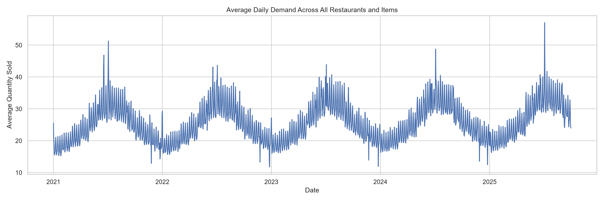
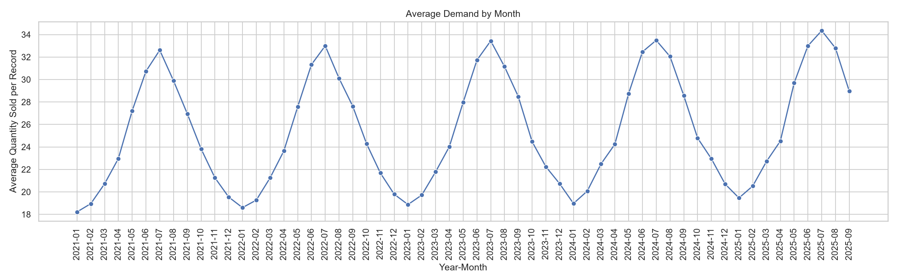
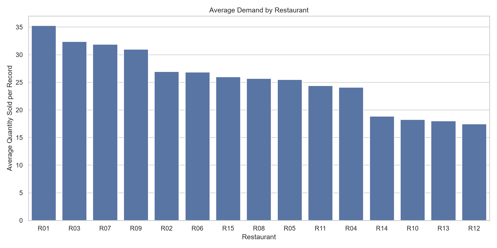
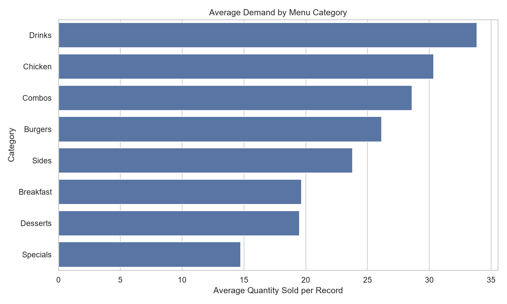

# HAVI QSR Demand Forecasting

**Daily demand forecasting across 15 Quick Service Restaurants (QSRs) using CatBoost, time-series feature engineering and model evaluation.**

[](https://www.python.org/)
[](https://catboost.ai/)
[](https://github.com/Koladeadebiyi/HAVI-QSR-Demand-Forecasting)

## 1. Project Overview

Accurate demand forecasting is essential to effective restaurant supply chain management. Underestimating demand can lead to stockouts, lost sales and poor customer experience, while overestimating demand can result in food waste, excess inventory and unnecessary operating costs.

This project develops a machine learning forecasting solution for a Quick Service Restaurant (QSR) network. The objective is to predict daily sales quantities for 50 menu items across 15 restaurants, using historical demand patterns and external business factors.

The project covers the end-to-end forecasting workflow, from exploratory data analysis and feature engineering to model development, validation, forecast generation and performance evaluation.

## 2. Project Scope

| Metric | Description |
|---|---:|
| Restaurants | 15 |
| Menu items | 50 |
| Product categories | 8 |
| Restaurant-item combinations | 750 |
| Historical dataset | 1,369,500 records |
| Historical period | January 2021 – December 2025 |
| Forecast period | October – December 2025 |
| Forecast horizon | 92 days |
| Forecast records | 69,000 |

The forecasting task required predictions for every restaurant-item combination across the 92-day Q4 period.

## 3. Technical Approach

The project followed a structured machine learning workflow.

### A. Exploratory Data Analysis

The exploratory analysis examined demand patterns across time, restaurants, menu items and external factors.

Key areas investigated included:

- Daily, monthly and quarterly demand trends.
- Restaurant-level and menu-item-level demand distribution.
- Weekday versus weekend demand.
- Demand variability and intermittent sales.
- Temperature and precipitation relationships.
- Holiday and special-event effects.
- Promotional activity and observed demand differences.

**Selected exploratory analysis**









### B. Feature Engineering

Feature engineering focused on capturing temporal patterns, historical demand behaviour and differences between restaurant-item combinations.

The analysis incorporated:

- Calendar and time-based features.
- Historical demand and lag-based features.
- Rolling demand statistics.
- Restaurant and menu-item characteristics.
- Demand variability and intermittency.
- Zero-sales behaviour.
- External factors, including weather, holidays, events and promotions.

A key modelling consideration was preventing data leakage by ensuring that features used for forecasting were available at the forecast origin.

### C. Model Development

Three CatBoost-based modelling approaches were developed and evaluated.

| Model | Approach |
|---|---|
| CatBoost v1 | Initial baseline model |
| CatBoost v2 | Improved fixed-origin forecasting model |
| CatBoost v3 | Two-stage classification and regression approach |

The models were evaluated using time-aware validation and metrics relevant to demand forecasting.

### D. Model Evaluation

The following metrics were used:

- **wMAPE:** Weighted forecast error relative to actual demand.
- **MAE:** Average absolute prediction error.
- **RMSE:** Penalises larger prediction errors.
- **Bias:** Measures systematic over- or under-forecasting.

## 4. Model Performance

### Validation results

| Metric | CatBoost v1 | CatBoost v2 | CatBoost v3 |
|---|---:|---:|---:|
| wMAPE | 15.0948% | **14.6904%** | 14.7388% |
| MAE | 4.8406 | **4.7109** | 4.7265 |
| RMSE | 9.4464 | **9.3312** | 9.3321 |
| Bias | -1.6530% | -0.0758% | +0.0524% |

**Selected model: CatBoost v2**

CatBoost v2 was selected as the preferred development model because it achieved the lowest validation wMAPE, MAE and RMSE among the three approaches.

It also demonstrated a low aggregate forecast bias.

## 5. Q4 2025 Forecast Evaluation

The selected model was used to generate daily demand forecasts for October through December 2025.

The resulting forecast contained 69,000 restaurant-item-date records.

### Forecast evaluation results

| Metric | Result |
|---|---:|
| Forecast records | 69,000 |
| Records with available actuals | 68,687 |
| Records with missing actuals | 313 |
| Actual demand scored | 1,593,979 |
| Predicted demand on scored records | 1,615,859.82 |
| wMAPE | **14.866%** |
| MAE | 3.4499 |
| RMSE | 6.7166 |
| Aggregate bias | +1.3727% |

The Q4 evaluation used only records with available actual quantities. The 313 records without actuals were excluded from accuracy calculations.

### Monthly forecast performance

| Month | Actual Demand | Forecast Demand |
|---|---:|---:|
| October 2025 | 586,492 | 593,411.39 |
| November 2025 | 521,896 | 531,567.92 |
| December 2025 | 485,591 | 490,880.52 |

### Category-level forecast accuracy

| Category | wMAPE |
|---|---:|
| Chicken | 13.42% |
| Combos | 13.82% |
| Drinks | 13.83% |
| Burgers | 14.90% |
| Sides | 15.24% |
| Desserts | 16.55% |
| Breakfast | 16.79% |
| Specials | 18.02% |

The category analysis shows that forecast accuracy varied across product groups, highlighting opportunities for more targeted modelling improvements.

## 6. Key Findings

The exploratory and modelling analyses revealed several important demand patterns:

- Weekend demand was approximately **19.6% higher** than weekday demand.
- Q3 recorded the strongest overall demand.
- Special-event days were associated with approximately **62.1% higher average demand**.
- Temperature showed a positive association with demand.
- Promotions were associated with increased demand in 657 of 714 comparisons examined.
- Forecast errors varied across categories, restaurants and individual menu items.

These findings demonstrate the importance of combining historical demand patterns with contextual business information when developing forecasting models.

*Note: Observed associations do not necessarily establish causal effects.*

## 7. Technology Stack

| Technology | Application |
|---|---|
| Python | Data analysis and model development |
| Pandas | Data manipulation and preparation |
| NumPy | Numerical computation |
| CatBoost | Machine learning and forecasting |
| Matplotlib / Seaborn | Exploratory data visualisation |
| Scikit-learn | Model evaluation and supporting analysis |
| Excel | Forecast reporting and business interpretation |
| Git / GitHub | Version control and project management |

## 8. Repository Structure

```text
HAVI-QSR-Demand-Forecasting/
│
├── data/
│   ├── raw/
│   └── processed/
│
├── docs/
│   ├── methodology.md
│   ├── feature_engineering.md
│   ├── project_findings.md
│   └── eda_*.md
│
├── models/
│   ├── catboost_v1.cbm
│   ├── catboost_v2.cbm
│   ├── catboost_v3_classifier.cbm
│   └── catboost_v3_regressor.cbm
│
├── outputs/
│   ├── eda/
│   ├── eda_04_external/
│   ├── forecasts/
│   └── model_evaluation/
│
├── src/
│   ├── EDA_*.py
│   ├── train_model_v1.py
│   ├── train_model_v2.py
│   ├── train_model_v3.py
│   ├── feature_engineering.py
│   ├── 21_generate_q4_forecast.py
│   └── ...
│
├── .gitignore
├── README.md
└── requirements.txt
```

## 9. Forecast Deliverable

The final forecast submission is available as an Excel workbook containing:

- Executive summary.
- Monthly forecast summary.
- Restaurant-level forecast summary.
- Menu-item-level forecast summary.
- Category-level forecast summary.
- Restaurant-item analysis.
- Daily forecast detail.
- Missing actuals report.
- Original uploaded forecast records.

**[View the final Q4 2025 forecast workbook](outputs/forecasts/HAVI_Q4_2025_Forecast_Submission_Final.xlsx)**

## 10. Reproducing the Project

Clone the repository:

```bash
git clone https://github.com/Koladeadebiyi/HAVI-QSR-Demand-Forecasting.git

cd HAVI-QSR-Demand-Forecasting
```

Create and activate a virtual environment:

```bash
python -m venv .venv
```

Windows:

```powershell
.venv\Scripts\activate
```

Install dependencies:

```bash
pip install -r requirements.txt
```

The original competition dataset is not included in this repository. To reproduce the complete analysis and model development, obtain the authorised dataset from the competition source and place it in the expected local data directory.

The Python scripts in `src/` contain the individual analysis, feature engineering, training, evaluation and forecasting stages. Run them in their intended workflow order, ensuring that the required intermediate datasets have been generated.

## 11. Limitations and Considerations

- The original competition dataset is excluded from the repository.
- Q4 evaluation is limited to the 68,687 forecast records with available actual quantities.
- Observed external-factor relationships should not be interpreted as proof of causation.
- Model performance may vary across restaurants, menu items and demand patterns.
- Further improvements could explore model ensembles, item-specific optimisation and more advanced intermittent-demand approaches.

## 12. Project Objective and Business Relevance

This project demonstrates how machine learning can support operational decision-making in the quick-service restaurant industry.

Accurate demand forecasts can help businesses improve:

- Food preparation and inventory planning.
- Procurement and replenishment decisions.
- Restaurant-level resource allocation.
- Waste reduction.
- Demand visibility and operational efficiency.

The project brings together data analytics, machine learning, forecasting evaluation and business interpretation to address a practical supply chain problem.

---

**Author:** Kolade Adebiyi

**GitHub:** [Koladeadebiyi](https://github.com/Koladeadebiyi)

**Project Repository:** [HAVI QSR Demand Forecasting](https://github.com/Koladeadebiyi/HAVI-QSR-Demand-Forecasting)
